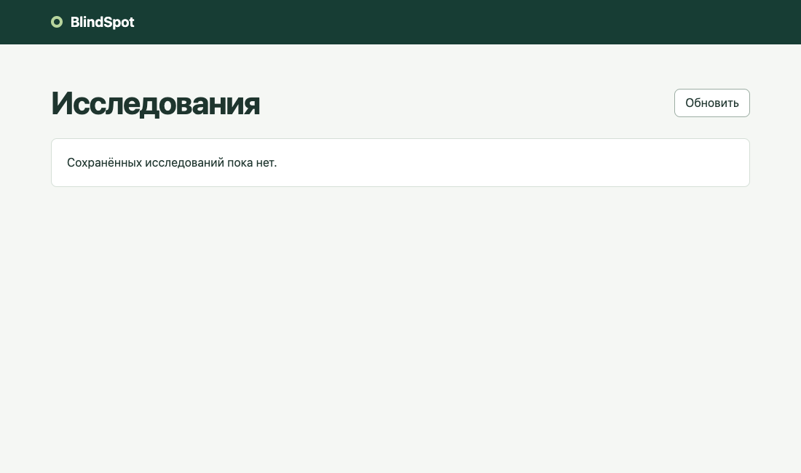

# Первый запуск BlindSpot

Проверка проведена 24 ноября 2026 года на macOS 27.0.1, Docker Engine 28.4.0, Compose 2.39.4. Контроллер работал в Linux/aarch64 с Python 3.13.12 и SQLite 3.40.1. Использован чистый том, список исследований пуст. Модели и таблицы для этого сценария не нужны. Для интеграционного теста записи создавались только во временной SQLite.

Исходная ревизия до изменений — `746a7a1`. Тестировались исходники и lock из коммита, содержащего этот протокол. ID локально собранного образа — `sha256:ec30544626654258a8a90adc852b138647b00edf6d4966a4390299b0434824c8`.

| Проверка | Наблюдаемый результат |
| --- | --- |
| Сборка по Dockerfile и requirements.lock | Установлены 13 зафиксированных пакетов с проверкой хешей. В контейнере команда pip check завершилась с сообщением No broken requirements found. |
| Публикация порта | Compose показал healthy и 127.0.0.1:8765 → 8000/tcp. С хоста GET /studies вернул HTTP 200 и `{"items":[]}`. |
| Страница и ресурсы | HTTP-проверка получила список, HTML, JS и CSS. Chrome 158.0.8127.88 показал пустой список, затем ошибку при прерванном запросе, после нажатия «Обновить» снова показал пустой список. |
| SQLite | Два теста внутри контейнера прошли. Первый открыл пустую базу, второй сохранил две тестовые записи, повторно инициализировал хранилище и сверил значения и порядок строк. |
| Повторный запуск | После пересоздания через Compose с флагами --no-build --pull never контроллер снова перешёл в healthy, а HTTP-проверка с хоста прошла. |
| Автономность | Отдельный контейнер из того же локального образа с --network none поднял Uvicorn, создал SQLite и вернул пустой список через свой loopback. |

При первом испытании внутренняя сеть Compose позволяла пройти healthcheck внутри контейнера, но Docker Desktop не публиковал порт на хосте. Контроллер переведён на стандартную сеть Compose с явной привязкой к 127.0.0.1. Проверки с хоста и в браузере повторены после исправления.

Команды для воспроизведения находятся в [руководстве](../development.md). Для проверки пересоздания добавьте `--force-recreate` к команде `docker compose up -d --no-build --pull never --wait`.

